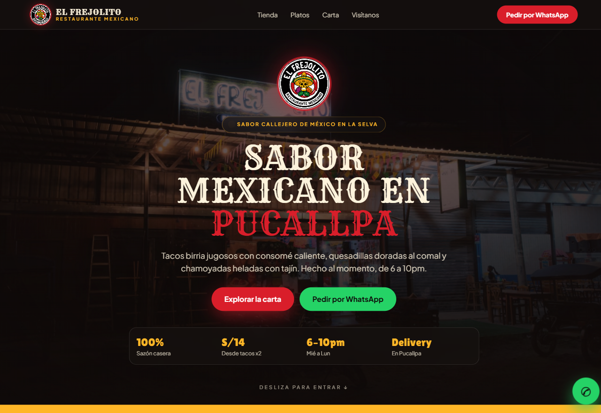
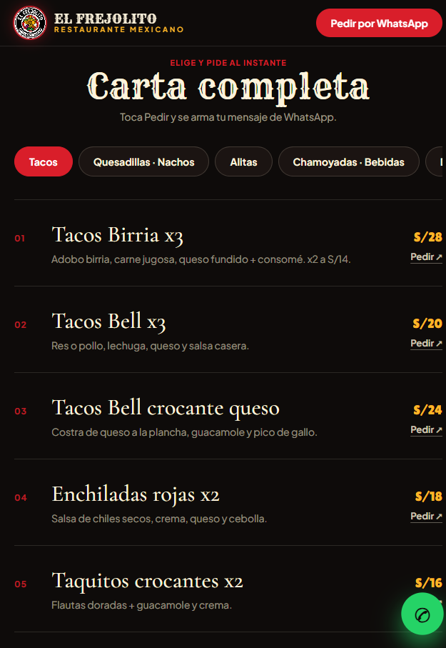
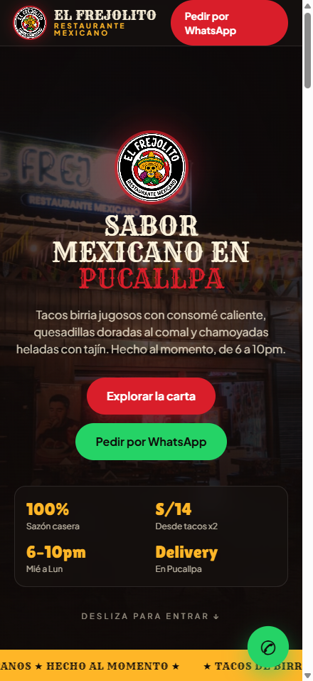
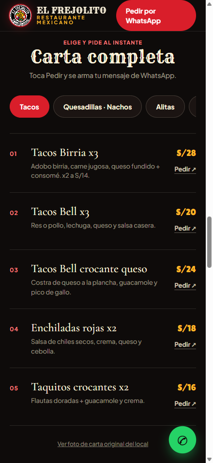

# Landing-Page-Frejolito — landing vitrina del restaurante mexicano El Frejolito

> Página estática de una sola vista para ver la tienda, los platos y la carta de El Frejolito (Pucallpa), y pedir por WhatsApp.

[](https://github.com/TeVerde29/Landing-Page-Frejolito)


## Capturas

Escritorio (1280px):

| Hero nocturno con logo y CTAs | Carta con filas editoriales por categoría |
|---|---|
|  |  |

Móvil 440x956 (iPhone 16 Pro Max):

| Hero en móvil | Carta en móvil |
|---|---|
|  |  |

El cliente recorre la página, filtra la carta por categoría y pulsa Pedir: se abre WhatsApp con el mensaje ya armado. El dueño actualiza platos y precios editando el arreglo `ITEMS` en `app.js`.

## Tabla de contenidos

- [Descripción](#descripción)
- [Demo](#demo)
- [Características principales](#características-principales)
- [Stack tecnológico](#stack-tecnológico)
- [Arquitectura](#arquitectura)
- [Instalación y uso](#instalación-y-uso)
- [Requisitos del sistema](#requisitos-del-sistema)
- [Carta y formato del pedido](#carta-y-formato-del-pedido)
- [Verificación](#verificación)
- [Notas de deploy](#notas-de-deploy)
- [Autor](#autor)

## Descripción

El Frejolito atiende de noche en Yarinacocha (Pucallpa) y recibe pedidos por WhatsApp al +51 907 318 885. Necesitaba una vitrina que muestre el local, los platos con foto real y la carta con precios en soles, sin carrito ni backend que mantener.

La página resuelve eso con un solo `index.html` más `styles.css` y `app.js`: hero de pantalla completa con `img/webp/local.webp` (`srcset` 800/1271), sección La tienda, 3 platos estrella con foto (`taco-birria.webp`, `taco-bell.webp`, `enchilada.webp`), carta filtrable por 6 categorías con foto fantasma de fondo por plato, 3 opiniones reales de Google Maps, mapa vivo embebido con horario y enlace a Maps, cierre con titular serif y footer en 4 columnas, menú hamburguesa en móvil, más botón flotante de WhatsApp.

## Demo

| Capa | URL |
|---|---|
| Producción (GitHub Pages) | https://teverde29.github.io/Landing-Page-Frejolito/ |
| Repo | https://github.com/TeVerde29/Landing-Page-Frejolito |

Decisiones clave: sitio 100% estático, sin `package.json` ni build — se publica tal cual. La carta vive en el arreglo `ITEMS` de `app.js`, no en un CMS: cada plato define categoría, nombre, precio, descripción, etiqueta, fragmento de mensaje y foto de fondo opcional (`img`). Cada botón Pedir construye una URL `https://wa.me/51907318885?text=...` con el plato precargado. El scroll suave usa Lenis 1.1.14 sincronizado al `ticker` de GSAP y los reveals usan ScrollTrigger con `scrub` (siguen al scroll); con `prefers-reduced-motion` todo el movimiento se desactiva.

## Características principales

- **Hero nocturno estilo Arko:** foto del local a pantalla completa en WebP con `srcset` y `preload`, parallax al scroll (`yPercent: 14` con scrub), logo circular, titular fluido en `clamp()` con fuente western y doble CTA.
- **Carta filtrable sin recargar:** 21 platos en 6 tabs accesibles por teclado (flechas, `aria-selected`), con Tacos como categoría inicial; al filtrar se refresca ScrollTrigger para no romper el scroll.
- **Filas editoriales con foto fantasma:** cada plato con foto real lleva su imagen de fondo difuminada desde el texto (máscara CSS, `height:100%` para no sangrar filas); filas sin foto quedan limpias. Nombre en serif (Georgia local), precio con `tabular-nums` y Pedir a la derecha con aire (`pr-4/sm:pr-6`).
- **Pedido por WhatsApp plato a plato:** cada tarjeta arma su mensaje (`quiero+Tacos+Birria+x3`); el botón flotante usa mensaje genérico de delivery con el glyph oficial de WhatsApp.
- **Botones con hover invertido:** familia `.btn-wa` (verde), `.btn-carta` (chamoy), `.btn-gps` (mango) y `.btn-ghost` (crema): sólido en reposo, transparente delineado en hover, press a 100ms.
- **Menú hamburguesa en móvil:** panel desplegable solo bajo `md` (X animada, cierre con Escape y al navegar); en PC el nav queda limpio con logo + links.
- **Mapa vivo en Visítanos:** iframe embebido de Google Maps (`output=embed`, `loading="lazy"`) en vez de foto repetida, con pill de horario.
- **Identidad del local:** logo en `img/webp/logo.webp` (22KB desde 1MB) en nav, hero, footer y favicon; display en `Rye` (la del rótulo en `logo con letra.png`), precios en `Lilita One`, cuerpo en `Plus Jakarta Sans`.
- **Paleta de `design.md`:** crema `#FDF3DC`, noche `#0E0B0A`, rojo chamoy `#D91E2A`, mango `#FFB627`, guacamole `#5A9A3B`; todo vía tokens CSS con `color-mix()`, sin hex sueltos.
- **Opiniones reales:** 3 reseñas de Google Maps con estrellas SVG accesibles (`sr-only`), badge Local Guide y enlace a ver todas.
- **Cierre estilo Arko:** titular serif centrado, pill de WhatsApp, motivo de círculos concéntricos y footer en 4 columnas (marca, visítanos, horario en una línea, contacto con iconos SVG).
- **Accesibilidad aplicada:** skip-link, foco visible mango 3px, textos chicos en `chamoyl` `#FF7A7A` (≥4.5:1 sobre noche), todo interactivo con 44px de toque, tabs y Pedir incluidos, `loading="lazy"` fuera del hero y fallback `noscript`.
- **SEO local y datos estructurados:** meta description, JSON-LD `Restaurant` con dirección, teléfono, horario y mapa.

## Stack tecnológico

| Capa | Tecnología | Función |
|---|---|---|
| Estructura | HTML5 en `index.html` | Secciones, nav, hero, carta, footer |
| Estilos | `styles.css` + Tailwind Play CDN | Tokens, cards oscuras, marquee, animaciones |
| Interacción | `app.js` (JS vanilla, sin build) | Render de carta, tabs, anclas |
| Scroll suave | Lenis 1.1.14 (unpkg) | `lerp: .11`, integrado a `gsap.ticker` |
| Animación | GSAP 3.12.5 + ScrollTrigger 3.12.5 (cdnjs) | Parallax hero y reveals `[data-reveal]` |
| Tipografías | Google Fonts: Rye, Lilita One, Plus Jakarta Sans | Display, precios, cuerpo (filas de carta en Georgia local) |
| Imágenes | `img/originales/` + `img/webp/` (14 y 14) | Fuentes JPG/PNG y versiones WebP q75–85 que sirve el sitio |
| Datos | `design.md`, `FREJOLITO_dulces.pdf` | Fuente de paleta, precios y dulces |

## Arquitectura

```text
Landing-Page-Frejolito/
├── index.html   # Estructura y contenido: nav + hamburguesa móvil, hero, tienda, platos, carta, opiniones, visitanos (mapa), cierre, footer
├── styles.css   # Tokens, botones btn-*, glass, card-dark, marquee, wa-float, reveals, menu-bg, skip-link
├── app.js       # Carta (ITEMS + render + tabs con teclado) y motion (Lenis + GSAP + anclas + nav + menú móvil)
├── design.md    # Sistema de diseño v2: estado real del landing
├── img/                 # Capturas del README (hero.png, carta.png...) + originales/ + webp/
├── img/originales/      # 14 fuentes: local.jpg, local-2.jpg, taco-birria.jpg, taco-bell.png, enchilada.jpg, quesadilla.jpg, cremas.jpg, tacos-burrito.jpg, alitas.jpeg, chamoyada-mango.jpg, pedido.jpg, carta.jpeg, logo.png...
├── img/webp/            # 14 generados (no editar a mano): local.webp, local-800.webp, local-2.webp, taco-birria.webp, taco-bell.webp, enchilada.webp, ...
└── FREJOLITO_dulces.pdf     # Carta de dulces mexicanos
```

- **Sin backend ni estado:** no hay API, formularios ni almacenamiento; el "pedido" es un deep link a WhatsApp.
- **Render en cliente:** la grilla `#grid` se pinta desde `ITEMS`; el HTML trae las 3 tarjetas estrella fijas y el resto lo genera `renderBase()`.
- **Motion aislado:** todo Lenis/GSAP vive al final de `app.js` con guardas `try/catch` y fallback a scroll nativo si el CDN falla; reveals con `scrub` y pausa de infinitas fuera de viewport.
- **Imágenes con nombre limpio:** sin espacios ni mayúsculas; el sitio solo referencia `img/webp/`. Flujo: original en `img/originales/` → generar WebP → referenciar.

## Instalación y uso

1. Clona el repo: `git clone https://github.com/TeVerde29/Landing-Page-Frejolito.git`.
2. Entra a la carpeta: `cd Landing-Page-Frejolito`.
3. Levanta un servidor local (verificado con 200 en todos los assets): `python -m http.server 8000`.
4. Abre `http://localhost:8000/index.html`. Requiere internet para los CDN (Tailwind, Lenis, GSAP, Fonts).

Flujo básico de uso:

1. El visitante entra al hero y pulsa Explorar la carta o Pedir por WhatsApp.
2. Filtra la carta con los tabs (tacos, alitas, dulces...).
3. Pulsa Pedir en un plato: se abre `wa.me` con el mensaje del plato listo para enviar.
4. Para cambiar precios o platos, edita el arreglo `ITEMS` en `app.js:4` y recarga.

## Requisitos del sistema

| Componente | Requisito mínimo |
|---|---|
| Navegador | Chrome, Edge, Firefox o Safari actual (CSS moderno + `backdrop-filter`) |
| Conexión | Internet activo para CDN y Google Fonts |
| Servidor local | Python 3 (`http.server`) o cualquier estático (Live Server, `npx serve`) |
| Pantalla | Responsive desde 360px; capturas desktop a 1280px y móvil a 440x956 |

## Carta y formato del pedido

Cada entrada de `ITEMS` (`app.js:4`) usa este formato:

```js
{c:'tacos', t:'Tacos Birria x3', p:'S/28',
 d:'Adobo birria, carne jugosa, queso fundido + consomé. x2 a S/14.',
 tag:'Más pedido', m:'quiero+Tacos+Birria+x3'}
```

`c` es la categoría del tab, `p` el precio en soles, `tag` la etiqueta de la tarjeta y `m` el fragmento del mensaje. El link final queda así:

```text
https://wa.me/51907318885?text=Hola%20Frejolito%2C%20quiero+Tacos+Birria+x3
```

Precios pendientes de validar con el local (ver `design.md`): Enchiladas Rojas (sticker corregido a S/18 en foto), Frappes S/10 vs S/12 y gaseosas en vidrio.

## Verificación

1. Estructura: `index.html` enlaza `./styles.css` y `./app.js`; no quedan bloques `<style>` ni `<script>` propios inline; balance de tags verificado por parser.
2. Assets: los 14 WebP de `img/webp/` + `index.html` responden 200 en el servidor local; el HTML no referencia ningún JPG/PNG.
3. Carta: 21 items en 6 categorías (Tacos inicial); cada tab muestra solo su grupo, el botón Pedir lleva el mensaje del plato y las filas con foto llevan fondo fantasma confinado (`height:100%`).
4. Movimiento: scroll suave sin saltos, parallax del hero y reveals con scrub por sección; con `prefers-reduced-motion` la página queda estática y legible; marquee y pulso se pausan fuera de viewport.
5. Capturas: `img/hero.png` e `img/carta.png` a 1280px y `img/hero-movil.png` e `img/carta-movil.png` a 440x956, tomadas del sitio corriendo en local.

## Notas de deploy

1. Es un sitio estático: basta servir la carpeta tal cual (GitHub Pages, Netlify, Cloudflare Pages).
2. GitHub Pages activo en `https://teverde29.github.io/Landing-Page-Frejolito/` (rama `main` / root).
3. El mapa embebido no necesita API key (`output=embed`); si el pin cae mal, fijarlo con coordenadas exactas.

---

**Autor**

**TeVerde29** — GitHub: [TeVerde29](https://github.com/TeVerde29) · Repo: [Landing-Page-Frejolito](https://github.com/TeVerde29/Landing-Page-Frejolito) · Negocio: El Frejolito, restaurante mexicano en Pucallpa (WhatsApp +51 907 318 885)

---

Si este proyecto te resultó útil, considera darle una estrella en GitHub.
